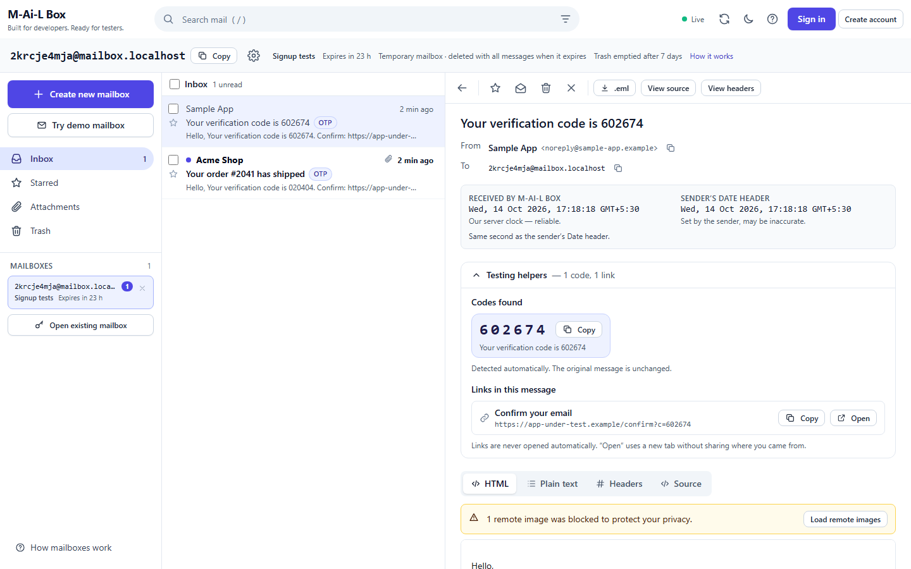
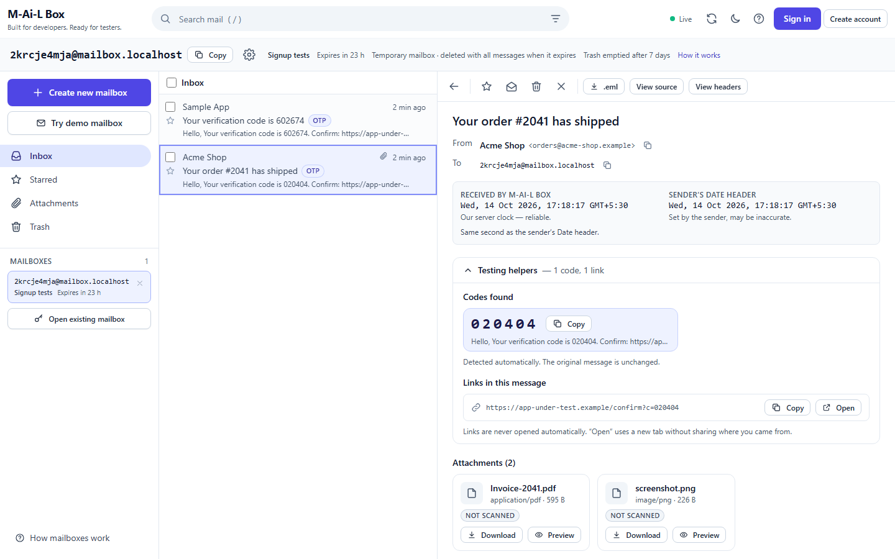
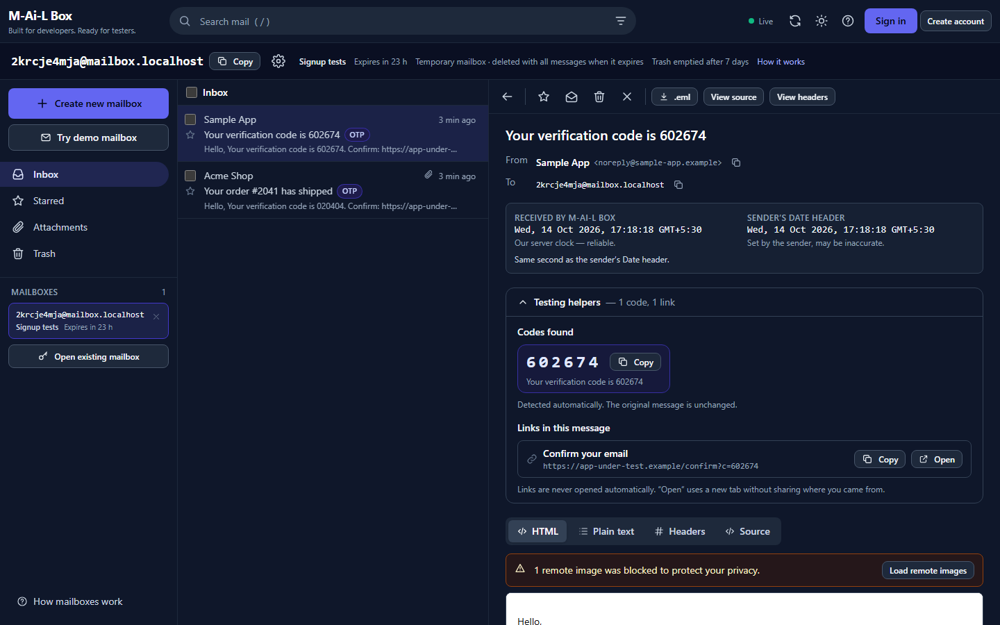
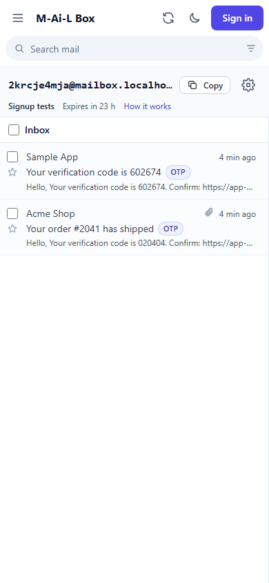

# M-Ai-L Box

[](https://github.com/G0DZuK/m-ai-l-box/actions/workflows/ci.yml) [](LICENSE)

*Built for developers. Ready for testers.*

M-Ai-L Box gives QA testers disposable e-mail addresses on **domains you own**, receives real mail sent to them, and shows it in a simple inbox: read the HTML safely, copy one-time codes, check the links, download attachments and the original `.eml`. Automated tests can wait for a message through an authenticated REST API.

> **What it can and cannot tell you.** M-Ai-L Box tests delivery to *its own configured receiving domains*. It cannot tell you whether a message would reach an unrelated Gmail, Outlook or corporate inbox: spam filtering, reputation and provider policy there are outside its view. It never generates working `@gmail.com` or `@outlook.com` addresses.

## Screenshots

These show real messages delivered over SMTP to an address created in the UI.

| Reader with detected OTP and links | Attachments with safe preview/download |
|---|---|
|  |  |
| **Dark theme** | **Mobile** |
|  |  |

## Highlights

- **Real inbound mail** through replaceable adapters: a built-in SMTP receiver (aiosmtpd), a Cloudflare Email Routing Worker (HMAC-signed), or Mailgun Routes (signature-verified).
- **Reliable pipeline:** the raw message is stored durably before it is acknowledged, then processed by Celery with retries and visible failure states. Duplicate deliveries are collapsed.
- **Security first:** private per-mailbox access tokens (the address alone grants nothing), sanitised HTML in a sandboxed iframe, remote images blocked until you opt in, short-lived signed download links, and tokens kept out of URLs and logs.
- **QA tooling:** one-time codes and links extracted automatically, server-side receive timestamps, and a long-poll `wait` API with scoped API keys for automated tests.
- **Stack:** FastAPI, SQLAlchemy and Alembic, PostgreSQL, Celery and Redis, S3/MinIO, and React with TypeScript, Vite and Tailwind. Runs locally with Docker Compose, plus a test suite of 57 tests.

## Contents

| Path | What it is |
|---|---|
| `backend/` | FastAPI app, SQLAlchemy models, Alembic migrations, Celery tasks, aiosmtpd receiver, tests |
| `frontend/` | React + TypeScript + Vite + Tailwind single-page app |
| `cloudflare-worker/` | Email Worker that relays Cloudflare Email Routing mail to the backend |
| `docker-compose.yml` / `docker-compose.prod.yml` | Local stack / production overrides with Caddy (HTTPS) |
| `docs/` | [Architecture](docs/ARCHITECTURE.md), [Deployment](docs/DEPLOYMENT.md), [API](docs/API.md), [QA automation](docs/QA_AUTOMATION.md), [Security & data handling](docs/SECURITY.md), [Costs, limits & open items](docs/COSTS_AND_LIMITS.md) |
| `examples/` | pytest, Playwright and curl automation examples |
| `scripts/` | `send_test_email.py` (real SMTP test sender), lite-mode launchers |

## Quick start (Docker)

Requirements: Docker with Compose v2.24 or later.

```bash
cp .env.example .env          # set SECRET_KEY; keep RECEIVING_DOMAINS=["mailbox.localhost"] for local use
docker compose up --build
```

- Web UI and API: <http://localhost:8000> (OpenAPI: <http://localhost:8000/api/docs>)
- SMTP receiver: `localhost:2525`. Point the application you are testing at it as its SMTP server.

Create a mailbox in the UI, then deliver a real message to it over SMTP:

```bash
python scripts/send_test_email.py <your-address>@mailbox.localhost --html --attach some.pdf
```

The message appears in the inbox within a couple of seconds, with no refresh needed.

**Local mode receives only mail that is sent directly to `localhost:2525`.** Docker Compose alone does not make your addresses reachable from the internet. Mail from external services (for example a staging app using SendGrid) needs a real domain, MX records and a public inbound service. [docs/DEPLOYMENT.md](docs/DEPLOYMENT.md) covers that setup.

## Quick start without Docker ("lite" mode)

This mode uses SQLite, a local folder for files and in-process mail handling. It is good for trying the app on one machine and is not meant for production.

```bash
sh scripts/run-lite.sh          # Windows: .\scripts\run-lite.ps1
```

## Demo mode

With `DEMO_MODE=true`, the UI offers **Try demo mailbox**. It creates a mailbox filled with **sample messages generated locally** on the server: an OTP mail, a password reset, an invoice with attachments and a Unicode newsletter. Demo mailboxes and messages carry a DEMO label everywhere. **Sample messages are not deliveries and prove nothing about whether real e-mail reaches the service.** To check real delivery, send a message over SMTP, as shown above, or through your configured inbound provider.

## How mailbox access works (plain language)

- Creating a mailbox needs no account. You get an **address** and a private **access key**.
- **The address is not a password.** Anyone can send mail to it, but only someone holding the access key can read it.
- The browser stores the access key for you. To use the mailbox from another browser or device, copy or download the key and choose **Open existing mailbox**.
- **If you lose the key** and the mailbox is not saved to an account, nobody can recover it, the operator included. The mailbox and its messages are deleted when it expires (24 hours by default; the time left is shown under the address).
- With an optional **account** you can save mailboxes so they never expire, keep messages and attachments long term, and store your own files (1 GB by default, counting saved messages).

## Running the tests

```bash
cd backend
python -m venv .venv && .venv/bin/pip install -r requirements-dev.txt     # Windows: .venv\Scripts\...
.venv/bin/python -m pytest
```

The suite runs against SQLite and local file storage, so it needs no external services. It covers mailbox isolation, authorization (tokens, sessions, scoped API keys, admin), MIME parsing, duplicate delivery, attachment access and signed links, unsafe HTML, quotas and limits, the real SMTP receiver, Cloudflare and Mailgun webhook signatures, the wait API, retention cleanup and log redaction.

Frontend: `cd frontend && npm install && npm run build` (type-checks, then builds).

## Attachment size, in short

The default limit is **25 MB per incoming message**, and both the limit and the provider's own cap apply. Attachments are base64-encoded inside an e-mail, which makes them about 33% larger. A 25 MB message therefore holds **at most about 18 MB of attachments**. All limits are configurable; see [docs/COSTS_AND_LIMITS.md](docs/COSTS_AND_LIMITS.md).

## License

[MIT](LICENSE) © 2026 Jerry
